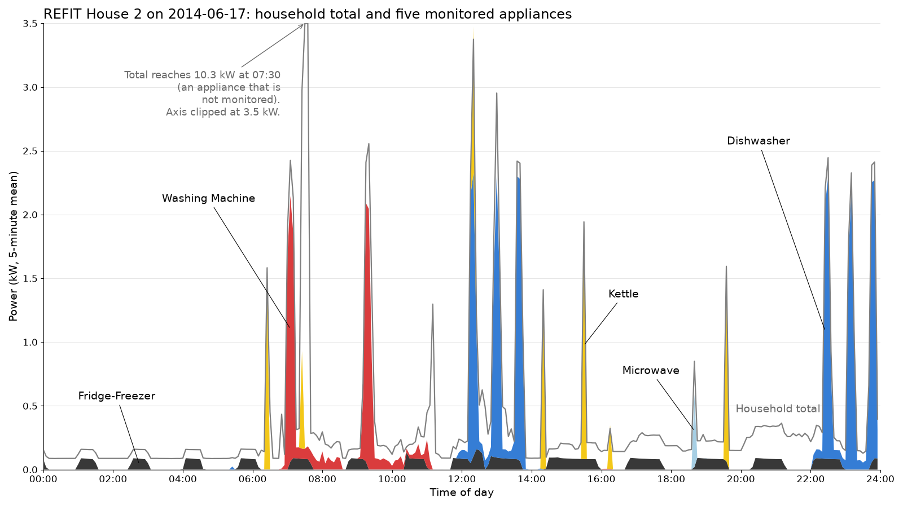

# First look at the REFIT data

`first_look.py` produces the first numbers quoted in the project proposal. It uses
two homes from the REFIT Electrical Load Measurements (Cleaned) dataset and does three things:

1. Describes House 2: number of rows, how many minutes have data, and how much of the
   total energy the nine monitored appliances account for.
2. Picks one complete day in House 2 where the washing machine, dishwasher, kettle and
   microwave all run (17 June 2014), saves it as `chart_day.json` (5-minute means) and draws
   `figures/house2_day.png`.
3. Trains two simple baselines on House 2 and tests them on House 5, at 1-minute resolution,
   for the five appliances both homes have: predicting the training mean, and a gradient
   boosting regressor on features of the household total. The score is mean absolute error in watts.



## Getting the data

Download `CLEAN_REFIT_081116.7z` (about 514 MB) from the dataset page with a normal browser:
https://pureportal.strath.ac.uk/en/datasets/refit-electrical-load-measurements-cleaned/

The archive holds 20 CSV files (about 6.9 GB unpacked). Only two are needed:

```
mkdir data
7z e CLEAN_REFIT_081116.7z -odata CLEAN_House2.csv CLEAN_House5.csv
```

## Running

```
pip install -r requirements.txt
python first_look.py --data-dir data --out-dir .
```

It writes `results.json`, `chart_day.json` and `figures/house2_day.png`. A run takes one to two
minutes on a laptop. The random seed is fixed, so the
numbers below should come out the same.

## Results

House 2:

| Quantity | Value |
|---|---|
| Rows in CLEAN_House2.csv | 5,733,526 |
| Minutes with data (first to last reading) | 75.4% |
| Share of total energy, all nine monitored appliances | 32.1% |
| Share of total energy, dishwasher | 13.1% |
| 17 June 2014, total energy | 10.34 kWh |
| 17 June 2014, dishwasher energy | 2.72 kWh |

Baselines, trained on House 2 and tested on House 5, mean absolute error in W
(lower is better):

| Appliance | Predict the mean | Gradient boosting |
|---|---|---|
| Kettle | 44.9 | 17.6 |
| Dishwasher | 107.1 | 67.6 |
| Washing machine | 44.3 | 43.6 |
| Microwave | 30.2 | 30.0 |
| Fridge-freezer | 55.6 | 48.0 |

For reference, the whole archive has 119,495,879 data rows across the 20 CSV files
(counted separately, not by this script).

## Caveats

- The baselines use one home for training and one for testing. Results on other pairs of
  homes can be quite different, so these numbers only show that the task is learnable for some
  appliances (the kettle and dishwasher) and hard for others.
- All REFIT homes are in the UK (Loughborough area, 2013 to 2015). Appliances, wiring and
  habits differ elsewhere, so the results may not carry over to other countries.

## Dataset licence and citation

The REFIT data is published by the University of Strathclyde under the Creative Commons
Attribution 4.0 licence (CC BY 4.0). The CSV files are not included in this repository.

Murray, D., Stankovic, L. and Stankovic, V. (2017). An electrical load measurements dataset
of United Kingdom households from a two-year longitudinal study. Scientific Data 4, 160122.
https://doi.org/10.1038/sdata.2016.122

Dataset: REFIT: Electrical Load Measurements (Cleaned). University of Strathclyde.
https://doi.org/10.15129/9ab14b0e-19ac-4279-938f-27f643078cec
