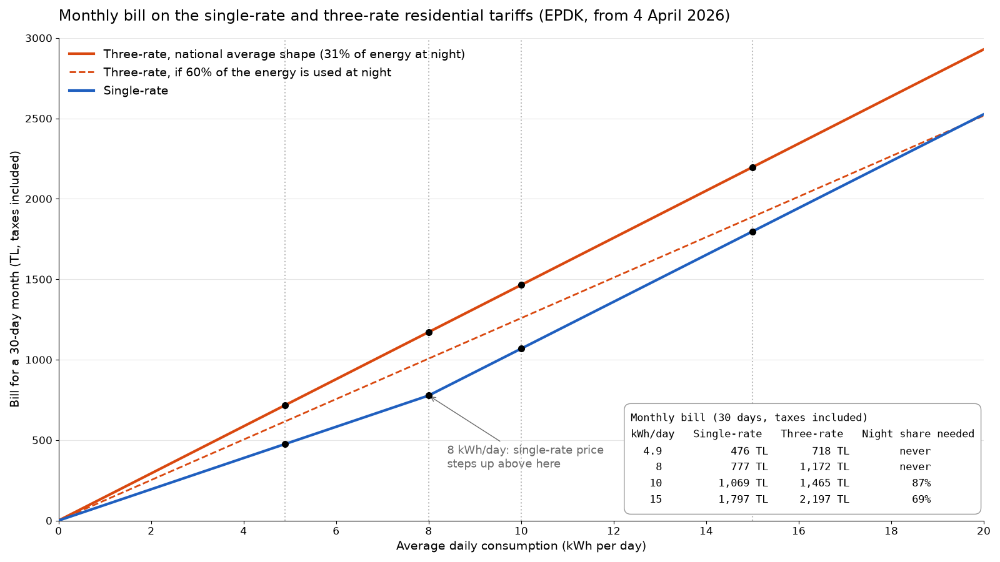
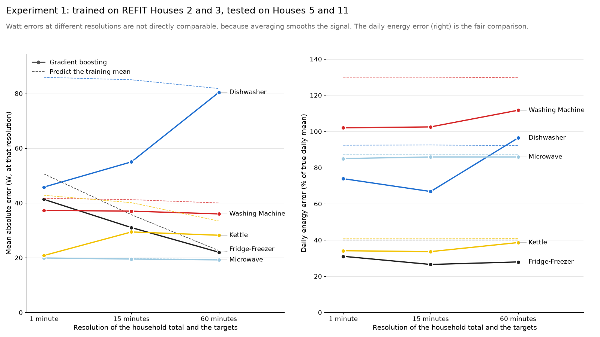
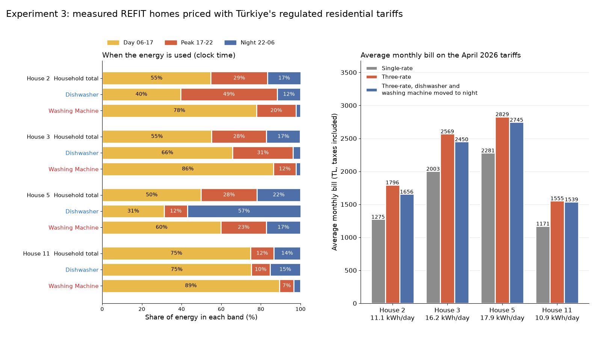

# 02 Adapting the project to Türkiye

After the idea presentation the instructor asked for two things: price the result with Türkiye's day and night tariff, and make the UK data suitable for Türkiye. The first tariff calculation is in `01_idea_proposal/analysis/`. This folder holds the measurements that followed.

| Folder | Question | Data |
|---|---|---|
| [profile/](profile/) | When does a typical Turkish household use its electricity, and which tariff is cheaper for it? | EPİAŞ residential profile coefficients, 2025, 21 distribution companies |
| [experiments/](experiments/) | Does the method survive hourly meter data and loads that UK homes do not have? What would the measured homes pay in Türkiye? | REFIT Houses 2 and 3 for training, Houses 5 and 11 for testing |

Each folder has its own README with the method, the full tables, the figures and the caveats. The main numbers of both folders were recomputed from the raw files with a separate script, and they matched.

## What the Turkish profile says

EPİAŞ publishes hourly load shapes for residential customers. On the national average shape 46.8% of the energy falls in the day band, 22.6% in the peak band and 30.6% in the night band.

| kWh per day | Single-rate, month (TL) | Three-rate, month (TL) | Night share needed for three-rate to be cheaper |
|---|---|---|---|
| 4.9 | 476 | 718 | never |
| 8 | 777 | 1,172 | never |
| 10 | 1,069 | 1,465 | 87% |
| 15 | 1,797 | 2,197 | 69% |

Up to 8 kWh a day the single-rate price (3.238 TL per kWh) is below the night price of the three-rate tariff (3.261 TL), so the three-rate tariff cannot win there. The average Turkish meter uses about 4.9 kWh a day. For most homes the useful advice is therefore to stay on the single-rate tariff, and the three-rate tariff only pays off for a home that uses well above 8 kWh a day and most of it at night.

## What the experiments say

All three use gradient boosting on the household total, the same baseline as in the first analysis. The deep learning model is not trained yet.

Resolution. Turkish smart meters are reported to give hourly data, so the baseline was run at 1, 15 and 60 minutes. The error is the daily energy error as a share of the appliance's true daily use.

| Appliance | 1 minute | 15 minutes | 60 minutes |
|---|---|---|---|
| Kettle | 34% | 34% | 39% |
| Dishwasher | 74% | 67% | 96% |
| Washing machine | 102% | 103% | 112% |
| Microwave | 85% | 86% | 86% |
| Fridge-freezer | 31% | 27% | 28% |

15-minute data loses almost nothing. At 60 minutes the dishwasher becomes worse than predicting the training mean. The washing machine and the microwave are poor at every resolution with this baseline.

Turkish loads. Synthetic air conditioner, electric water heater and tea maker signals were added to the test homes. The signal shapes are assumptions, not measurements. Mean absolute error in watts:

| Appliance | Clean | Loads the model never saw | Retrained with the loads |
|---|---|---|---|
| Kettle | 20.8 | 35.3 | 24.4 |
| Dishwasher | 45.8 | 66.7 | 53.8 |
| Washing machine | 37.3 | 45.6 | 36.3 |
| Microwave | 19.9 | 21.6 | 20.2 |
| Fridge-freezer | 41.3 | 41.9 | 41.9 |

Unseen loads raise the kettle error by 70% and the dishwasher error by 46%. Retraining with the loads in the training data recovers most of that.

Bills. The measured channels of the four homes were priced month by month with the April 2026 tariffs.

| Home | kWh per day | Night share | Single-rate (TL) | Three-rate (TL) | Three-rate, dishwasher and washing machine at night (TL) |
|---|---|---|---|---|---|
| House 2 | 11.1 | 17% | 1,275 | 1,796 | 1,656 |
| House 3 | 16.2 | 17% | 2,003 | 2,569 | 2,450 |
| House 5 | 17.9 | 22% | 2,281 | 2,829 | 2,745 |
| House 11 | 10.9 | 14% | 1,171 | 1,555 | 1,539 |

The single-rate tariff is cheaper in every billed month of every home. Moving the two machines to the night saves between 16 and 140 TL a month on the three-rate tariff and closes at most about 27% of the gap.

## What this changes in the project

1. The model should be trained and scored at 15-minute resolution as well as 1 minute. Hourly data is too coarse for the dishwasher with the current features.
2. Synthetic Turkish loads go into the training data from the start.
3. The demo reports two things for a home: which tariff is cheaper for it, and how much each appliance costs in each band. For most homes the tariff answer will be single-rate.

## Limits

- The EPİAŞ shape is a settlement average over millions of meters. A single home can look very different.
- No Turkish home has been measured yet. That step needs smart plugs.
- The synthetic load shapes are assumptions.
- Taxes are added by calculation (5% consumption tax on the energy part, then 10% VAT) and should be checked against a real bill.
- Tariff prices are those valid from 4 April 2026 and will change.
