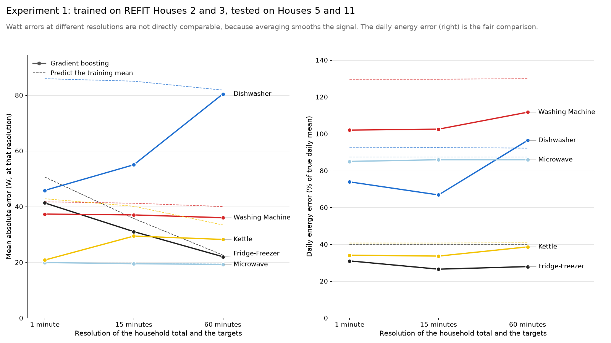
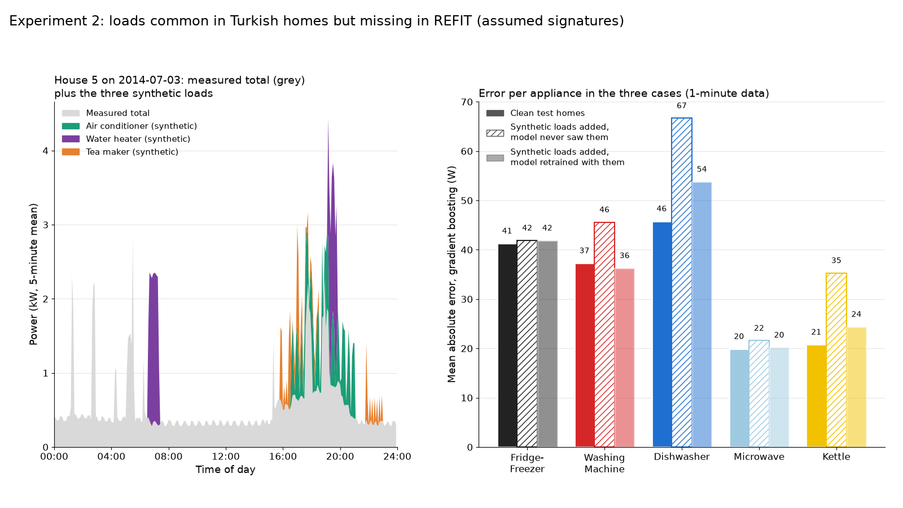
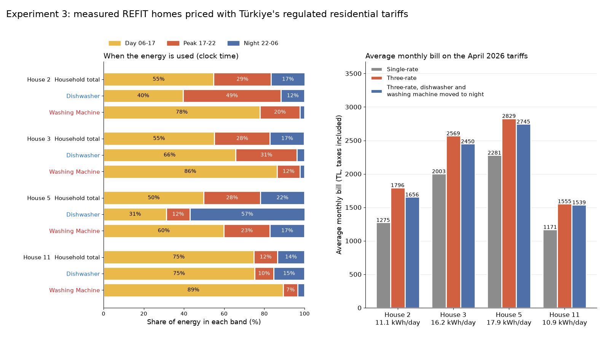

# Adaptation experiments for Türkiye

Our adaptation plan has four steps: test across homes and datasets, add loads that are common
in Turkish homes but missing in REFIT to the training data, evaluate at the coarse resolution
that Turkish smart meters give, and measure a Turkish home. The last step needs hardware. This
folder tries the other three on REFIT data, as first evidence for the plan.

`adaptation_experiments.py` runs three experiments. All of them use four REFIT homes. Houses 2
and 3 are used for training and Houses 5 and 11 for testing, so the test homes are never seen
in training.

1. Resolution: the baselines at 1-minute, 15-minute and 60-minute resolution.
2. Turkish loads: synthetic air conditioner, water heater (termosifon) and tea maker
   (çay makinesi) signals added to the household totals.
3. Bills: the measured appliance channels of each home priced with Türkiye's single-rate and
   three-rate tariffs, month by month.

Experiments 1 and 2 use only the two baselines from `01_idea_proposal/analysis/first_look.py`:
predicting the training mean, and a gradient boosting regressor on window features of the
household total. The deep learning model of the project is future work and is not used here.

## Getting the data

The REFIT cleaned dataset is on Zenodo (record 5063428, DOI 10.5281/zenodo.5063428), and each
house can be downloaded on its own. Four files are needed, about 1.4 GB together:

```
mkdir data
for h in 2 3 5 11; do
  curl -L -o data/CLEAN_House$h.csv \
    https://zenodo.org/api/records/5063428/files/CLEAN_House$h.csv/content
done
```

The CSV files are not included in this repository.

## Running

```
pip install -r requirements.txt
python adaptation_experiments.py --data-dir data --cache-dir cache --out-dir .
```

The first run reads each CSV once and saves a 1-minute version in `cache/` (about 160 MB in
all), so later runs skip that step. The script writes `results.json` and three figures in
`figures/`. A full run took about 3.5 to 5 minutes on a laptop with 8 GB of RAM and used about
1.4 GB of memory at most. The random seeds are fixed, and two runs gave identical numbers.

Each CSV has a reading about every 8 seconds. The script averages the readings to a regular
1-minute grid. A minute with no reading is left out. If the total has a reading but an
appliance does not, the appliance is set to 0 W. As in `first_look.py`, gradient boosting is
trained on a random sample of 600,000 rows at 1 minute; at 15 and 60 minutes all rows are used
because there are fewer of them.

## Experiment 1: resolution

The household total and the appliance channels are averaged to 15-minute and 60-minute bins.
Averaging power keeps the energy the same. A bin needs data in at least 80% of its minutes,
otherwise it is left out. The rolling windows of the features are scaled to the resolution
(5 to 61 minutes at 1 minute, 45 minutes to 6 hours at 15 minutes, 3 to 25 hours at 60
minutes). Both baselines are trained and tested again at each resolution.

Two scores are reported for each appliance. The first is the mean absolute error in watts at
that resolution. The second is the daily energy error: for each test day with data in at least
90% of its minutes (921 days over the two test homes), the absolute difference between
predicted and true kWh. We give the median of these daily differences, and the mean of them as
a share of the true mean daily energy. A share of 100% is what you would get by always
predicting 0 kWh.



Gradient boosting, trained on Houses 2 and 3, tested on Houses 5 and 11:

| Appliance | True kWh per day | MAE 1 min (W) | MAE 15 min (W) | MAE 60 min (W) | Daily error 1 min | Daily error 15 min | Daily error 60 min |
|---|---|---|---|---|---|---|---|
| Kettle | 0.53 | 20.8 | 29.4 | 28.2 | 0.14 kWh, 34% | 0.14 kWh, 34% | 0.15 kWh, 39% |
| Dishwasher | 0.93 | 45.8 | 55.0 | 80.4 | 0.58 kWh, 74% | 0.51 kWh, 67% | 0.77 kWh, 96% |
| Washing machine | 0.54 | 37.3 | 37.0 | 36.0 | 0.34 kWh, 102% | 0.35 kWh, 103% | 0.36 kWh, 112% |
| Microwave | 0.44 | 19.9 | 19.5 | 19.2 | 0.15 kWh, 85% | 0.15 kWh, 86% | 0.14 kWh, 86% |
| Fridge-freezer | 1.09 | 41.3 | 31.0 | 22.0 | 0.33 kWh, 31% | 0.27 kWh, 27% | 0.27 kWh, 28% |

Predicting the training mean, for comparison (its daily error barely changes with resolution; its MAE in watts falls at coarser resolution, for the kettle from 42.8 W at 1 minute to 33.4 W at 60 minutes):

| Appliance | MAE 1 min (W) | Daily error 1 min |
|---|---|---|
| Kettle | 42.8 | 0.17 kWh, 41% |
| Dishwasher | 85.9 | 0.95 kWh, 92% |
| Washing machine | 41.7 | 0.57 kWh, 130% |
| Microwave | 19.8 | 0.14 kWh, 87% |
| Fridge-freezer | 50.6 | 0.41 kWh, 40% |

At 1 minute the gradient boosting errors (kettle 21 W, dishwasher 46 W, washing machine 37 W)
are of the same size as the earlier House 2 to House 5 baseline in `01_idea_proposal` (kettle
18 W, dishwasher 68 W, washing machine 44 W). The two runs use different splits, so this is only
a rough comparison. The dishwasher changed the most: its error fell from 68 W to 46 W after we
added a second training home and a second test home. Going from 1 minute to 15 minutes costs
almost nothing in daily energy, and the dishwasher and fridge-freezer even do a little better.
Hourly data is where the dishwasher breaks down: its daily error rises from 74% to 96%, which
is worse than predicting the training mean. At 60 minutes the kettle model (28.2 W) is only about 5 W better than the mean
predictor (33.4 W). The microwave model was already no better than the mean predictor at 1 minute (19.9 W
against 19.8 W). The washing machine model is only a little better than the mean predictor by
MAE (37.3 W against 41.7 W), and its daily error of 102% is worse than always predicting 0 kWh.
Neither had much accuracy to lose at coarser resolution.

## Experiment 2: loads typical of Turkish homes

REFIT homes do not have an air conditioner, an electric storage water heater or a tea maker,
all of which are common in Türkiye. We made simple synthetic signals for the three and added
them to the household totals. The appliance targets stay the same, so the model still has to
find the five REFIT appliances, now with extra loads in the total.

These signatures are assumptions with the parameters below. They are not measurements of
Turkish homes. All of them are in one block (`SYNTH`) near the top of the script.

| Load | Assumed signature |
|---|---|
| Air conditioner | On a share of days from May to September (10% in May, 40% in June, 60% in July and August, 30% in September), a run starting between 13:00 and 19:00 and lasting 3 to 6 hours. The compressor draws 900 to 1300 W, on for 8 to 20 minutes and off for 5 to 12 minutes, and a 40 W indoor fan runs the whole time. |
| Water heater (termosifon) | A 2000 W block lasting 20 to 50 minutes. It starts between 06:00 and 08:30 on 70% of days and between 18:00 and 22:00 on 80% of days. |
| Tea maker (çay makinesi) | 2 to 4 sessions a day, starting in one of three windows (07:00 to 09:00, 15:00 to 17:30, 19:00 to 22:30). A boil of 1600 to 1800 W for 4 to 7 minutes, then one-minute keep-warm pulses every 8 to 12 minutes for 30 to 90 minutes. |

Over the test homes this adds about 3.2 to 3.4 kWh per day on average (water heater 1.7, tea
maker 0.9, air conditioner 0.5 to 0.7), on top of a measured 17.9 kWh per day in House 5 and
10.9 kWh per day in House 11.

We measured three cases at 1-minute resolution. In the first, the model is used as is on the
clean test homes (the same numbers as Experiment 1). In the second, the same model is applied
to the test totals with the synthetic loads added, which it has never seen. In the third, the
model is trained again with the same kind of synthetic loads added to the training totals and
tested on the test totals with the loads added. Training and test homes get their loads from
different random seeds, so the retrained model sees the same kind of load but never the same
events.



Gradient boosting, mean absolute error in W (daily energy error in brackets):

| Appliance | Clean test homes | Loads added, model never saw them | Loads added, model retrained with them |
|---|---|---|---|
| Kettle | 20.8 (34%) | 35.3 (61%) | 24.4 (35%) |
| Dishwasher | 45.8 (74%) | 66.7 (64%) | 53.8 (69%) |
| Washing machine | 37.3 (102%) | 45.6 (123%) | 36.3 (103%) |
| Microwave | 19.9 (85%) | 21.6 (85%) | 20.2 (85%) |
| Fridge-freezer | 41.3 (31%) | 41.9 (30%) | 41.9 (30%) |

The kettle is hurt the most by loads it has never seen: its error goes from 21 W to 35 W and its
daily error almost doubles. This makes sense, because a tea maker boil looks very much like a
kettle boil. Retraining with synthetic loads brings the kettle back to 24 W and the washing
machine back to its clean level, and recovers about two thirds of the extra dishwasher error.
The dishwasher daily error falls when the unseen loads are added even though its watt error
rises, which suggests that over-predictions on some days happen to cancel under-predictions on
others; we would not read this as an improvement. The fridge-freezer and microwave hardly move.

## Experiment 3: a year of bills

This experiment uses the measured channels directly, with no model. For each home over its
whole recording it gives the average daily kWh, the share of the household total and of each
shiftable appliance (dishwasher, washing machine, and tumble dryer in Houses 3 and 5; none of
the four homes has a washer dryer) in the day (06:00 to 17:00), peak (17:00 to 22:00) and night
(22:00 to 06:00) bands by clock time, and the average monthly bill.

The prices are the EPDK regulated national tariff for low-voltage residential customers
(mesken, AG), valid from 4 April 2026. The all-in price per kWh is our calculation from the
published tax rates, not part of the EPDK table: (energy × 1.05 + 242.49 distribution) × 1.10 /
100.

| Tariff | All-in price (TL per kWh) |
|---|---|
| Single-rate, up to 8 kWh per day on average | 3.238 |
| Single-rate, the part above | 4.857 |
| Three-rate, day | 4.920 |
| Three-rate, peak | 6.996 |
| Three-rate, night | 3.261 |

Bills are worked out per calendar month. A month is billed only if at least 80% of its minutes
have data; the first and last months of each recording and months with long gaps are skipped
(the list is in `results.json`). Gaps inside a billed month are filled with that month's mean
power in the same band. For the single-rate bill, the 8 kWh limit is applied to the month's
average daily use: the first 8 kWh per day times the days in the month are charged at the low
price and the rest at the high price. The shifted bill moves the dishwasher and washing machine
energy that falls in the day and peak bands to the night band and prices it on the three-rate
tariff. The tumble dryer is not moved.



| Home | kWh per day | Months billed | Total in day / peak / night | Dishwasher in day / peak / night | Washing machine in day / peak / night |
|---|---|---|---|---|---|
| House 2 | 11.1 | 14 | 55 / 29 / 17% | 40 / 49 / 12% | 78 / 20 / 2% |
| House 3 | 16.2 | 17 | 55 / 28 / 17% | 66 / 31 / 4% | 86 / 12 / 2% |
| House 5 | 17.9 | 17 | 50 / 28 / 22% | 31 / 12 / 57% | 60 / 23 / 17% |
| House 11 | 10.9 | 10 | 75 / 12 / 14% | 75 / 10 / 15% | 89 / 7 / 3% |

The tumble dryer uses 76 / 21 / 3% in House 3 and 56 / 27 / 18% in House 5.

| Home | Average monthly kWh | Single-rate (TL) | Three-rate (TL) | Three-rate, machines moved to night (TL) | kWh moved per month |
|---|---|---|---|---|---|
| House 2 | 343 | 1,275 | 1,796 | 1,656 | 53 |
| House 3 | 494 | 2,003 | 2,569 | 2,450 | 55 |
| House 5 | 551 | 2,281 | 2,829 | 2,745 | 38 |
| House 11 | 315 | 1,171 | 1,555 | 1,539 | 9 |

The single-rate tariff is cheaper for all four homes in every billed month, by 19% to 29% on
average. Only 14% to 22% of their energy falls in the night band, and the night price (3.261 TL)
is slightly above the single-rate low tier (3.238 TL), so the three-rate tariff could only win
for a home that uses a lot at night and well above 8 kWh per day. Moving the dishwasher and
washing machine to night saves 16 to 140 TL a month, which closes less than a third of the gap.
House 2 averages 11.1 kWh per day, close to the 10.3 kWh of the example day priced in
`01_idea_proposal`.

## Limits

- Only the two simple baselines are tested. A deep learning model may react differently to
  coarse data and to new loads, so these results say what the baselines do, nothing more.
- The air conditioner, water heater and tea maker signals are assumed signatures with made-up
  parameters. Real Turkish appliances may look different, and the result of Experiment 2
  depends on how close our guesses are.
- All four homes are in the UK and were recorded in 2013 to 2015. UK habits, appliances and the
  UK calendar shape when energy is used, so the band shares and bills say little about a
  Turkish household.
- Four homes is a small sample. Two are used for training and two for testing, and another
  split of the homes could give quite different numbers.
- The 60-minute results assume hourly means of the total. We have not checked what a real
  Turkish smart meter records or how often it can be read.
- The tax part of the all-in price is our own calculation and should be checked against a real
  bill. EPDK changes the tariff several times a year, so the constants in the script need
  updating before the bills are reused.

## Dataset licence and citation

The REFIT data is published under the Creative Commons Attribution 4.0 licence (CC BY 4.0).

Murray, D., Stankovic, L. and Stankovic, V. (2017). An electrical load measurements dataset
of United Kingdom households from a two-year longitudinal study. Scientific Data 4, 160122.
https://doi.org/10.1038/sdata.2016.122

Dataset: REFIT: Electrical Load Measurements (Cleaned). Zenodo.
https://doi.org/10.5281/zenodo.5063428
