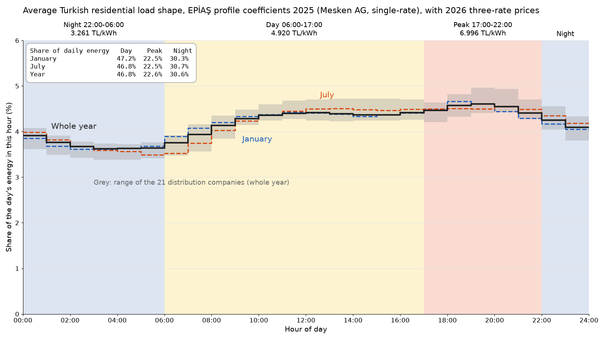
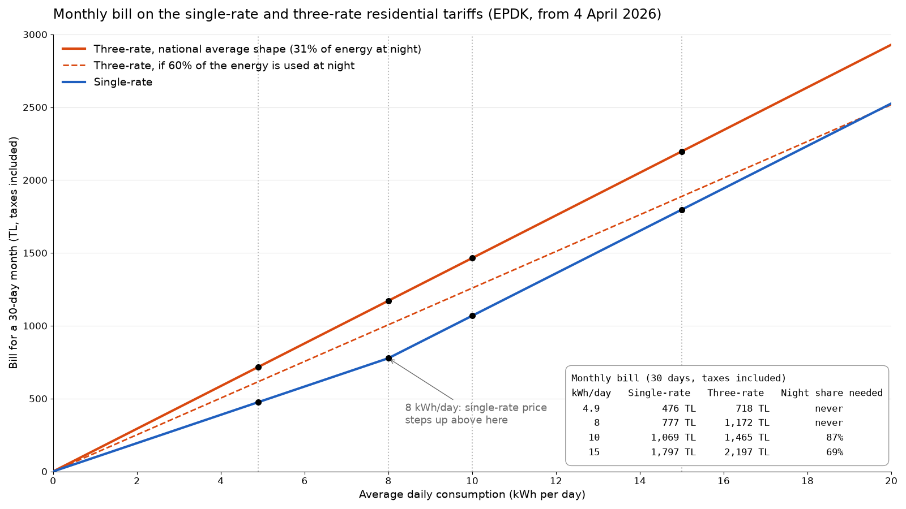

# Turkish household load shape and tariff choice

The first tariff analysis (`01_idea_proposal/analysis/tariff_cost.py`) priced one day of a UK
home with the Turkish tariffs. This folder does the same kind of calculation with Turkish data.
`profile_cost.py` uses the hourly load profiles that EPİAŞ publishes for residential customers
to answer three questions:

1. How much of a typical Turkish household's daily energy falls in the day, peak and night
   bands of the three-rate tariff?
2. What would that household pay per day and per month on the single-rate tariff and on the
   three-rate tariff, at 4.9, 8, 10 and 15 kWh per day?
3. How much of its energy would a household have to use at night before the three-rate tariff
   becomes the cheaper one?

## The data

EPİAŞ (Enerji Piyasaları İşletme A.Ş., the Turkish market operator) publishes "weighted profile
coefficients" (ağırlıklandırılmış profil katsayıları) every year. Suppliers use them to split a
monthly meter reading into hours for settlement. There is one series per distribution company,
subscriber group and meter reading type.

We use the 2025 coefficients, which are the newest ones published as open Excel files:

- Announcement page: https://www.epias.com.tr/genel/2025-yili-profil-katsayilari/
- Files: `https://www.epias.com.tr/wp-content/uploads/2024/11/<month>-2025.xlsx`, one per month
  (September is `profil_katsayilari_eylul_2025_v2.xlsx`), about 21 MB each
- Downloaded on 13 November 2026

The 2026 announcement says the 2026 coefficients are on the EPİAŞ transparency platform. Its
web service returned "authentication required" when we tried it without an account, so we did
not use 2026.

Each monthly file has about 390,000 rows and these columns:

| Column | Meaning (checked in the data) |
|---|---|
| DONEM | The month (first day of the month) |
| ORG_AD | Distribution company, 21 of them |
| PROFIL_ABONE_GRUP | Subscriber group. We use `Mesken - AG` (residential, low voltage) |
| OKUMA_TIP | Meter reading type: `Tek Zamanlı` (single-rate) or `Üç Zamanlı` (three-rate) |
| SAAT | Start of the hour, e.g. 2025-01-01 17:00 is 17:00 to 18:00 |
| CARPAN | The coefficient for that hour |

We checked what the coefficients mean before using them (the numbers are in
`mesken_ag_hourly_2025_checks.json`):

- For single-rate meters the coefficients of one company add up to exactly 1 over the month.
  So a coefficient is the share of the month's energy used in that hour.
- For three-rate meters they add up to 1 inside each band (06:00 to 17:00, 17:00 to 22:00,
  22:00 to 06:00), so 3 over the month. This only works out if SAAT is the start of the hour
  and the bands match the tariff bands, which confirms both.
- In every month and company, the three-rate coefficient equals the single-rate coefficient
  divided by the single-rate total of its band (largest difference 3e-16 on the raw files, about 3e-10 on the CSV kept here because it is rounded to 10 decimals). A three-rate meter
  already records how much energy was used in each band, so EPİAŞ only needs to spread each
  band's energy over its hours, and it does that with the single-rate shape.

The last point means the files contain only one residential load shape. There is no separate
shape for households that chose the three-rate tariff, so we cannot say from this data how
three-rate customers split their energy between the bands. The break-even night share below
is our way around that.

`mesken_ag_hourly_2025.csv` is the small processed file the analysis runs from (6,048 rows).
For each month, company and hour of day it holds the single-rate coefficients summed over all
days of the month (`single_share`, the share of the month's energy used in that hour of day)
and the same sum for the three-rate coefficients (`three_within_band`). The source URL and
download date are written at the top of the file. The raw Excel files are not in the
repository.

## How the national shape is built

1. For each company and month, add up the single-rate coefficients of each hour of day over all
   days of the month. Because the coefficients already carry each day's weight within the
   month, this gives the share of the month's energy used in each hour of day.
2. For each month, take the plain average of the 21 companies. Each company counts the same,
   because the files give no consumption figures to weight them by.
3. January is the winter shape and July is the summer shape. The year shape is the average of
   the 12 monthly shapes weighted by the number of days in each month. This treats every day of
   the year as using the same amount of energy, since the coefficients are scaled to 1 in each
   month and so carry no information about which months use more.

## Tariffs

EPDK regulated tariff for low-voltage residential customers (mesken, AG), valid from 4 April
2026. Prices without taxes, kuruş per kWh:

| | Energy | Distribution |
|---|---|---|
| Single-rate, up to an average of 8 kWh per day | 49.4065 | 242.49 |
| Single-rate, the part above 8 kWh per day | 189.5808 | 242.49 |
| Three-rate, day (06:00 to 17:00) | 195.0640 | 242.49 |
| Three-rate, peak (17:00 to 22:00) | 374.7551 | 242.49 |
| Three-rate, night (22:00 to 06:00) | 51.3656 | 242.49 |

We add a 5% consumption tax on the energy part and then 10% VAT on everything, so the
price with taxes is (energy x 1.05 + 242.49) x 1.10 / 100 TL per kWh. This tax step is our own
calculation from the published tax rates and is not part of the EPDK table.

| Tariff | TL per kWh with taxes |
|---|---|
| Single-rate, first 8 kWh per day | 3.238 |
| Single-rate, above 8 kWh per day | 4.857 |
| Three-rate, day | 4.920 |
| Three-rate, peak | 6.996 |
| Three-rate, night | 3.261 |

## Running

```
pip install -r requirements.txt
python profile_cost.py --out-dir .
```

This needs only the processed CSV and runs offline in a few seconds. It writes `results.json`,
`figures/hourly_shape_bands.png` and `figures/bill_vs_consumption.png`.

To rebuild the processed CSV from the original Excel files (downloads about 260 MB into `raw/`,
which is ignored by git, and takes a few minutes):

```
python profile_cost.py --build --download --raw-dir raw
```

Nothing in the script is random. A seed is still set so that later additions stay repeatable.

## Results

### Share of daily energy in each band

| Shape | Day (06 to 17) | Peak (17 to 22) | Night (22 to 06) |
|---|---|---|---|
| January | 47.2% | 22.5% | 30.3% |
| July | 46.8% | 22.5% | 30.7% |
| Whole year | 46.8% | 22.6% | 30.6% |

Across the 21 companies the yearly night share goes from 28.6% (İstanbul Anadolu Yakası) to
31.6% (Toroslar). With the year shape, one kWh on the three-rate tariff costs 4.882 TL on
average.



### Bills

A month is 30 days. The single-rate bill depends only on how much is used. The three-rate bill
below assumes the household follows the national single-rate shape for the whole year. The
January and July shapes differ from the year-shape bill by less than 1.2 TL a month, so they are
left out of the table (they are in `results.json`). We could not work out a bill with a
three-rate customers' shape because the data has none (see above).

| kWh per day | Single-rate, day | Three-rate, day | Single-rate, month | Three-rate, month | Difference, month |
|---|---|---|---|---|---|
| 4.9 | 15.87 TL | 23.92 TL | 475.99 TL | 717.64 TL | +241.65 TL |
| 8 | 25.90 TL | 39.06 TL | 777.13 TL | 1,171.66 TL | +394.53 TL |
| 10 | 35.62 TL | 48.82 TL | 1,068.55 TL | 1,464.57 TL | +396.02 TL |
| 15 | 59.90 TL | 73.23 TL | 1,797.11 TL | 2,196.86 TL | +399.75 TL |

The difference is three-rate minus single-rate, so a positive number means the three-rate
tariff costs more.



### Break-even night share

For each level we raised the share of energy used at night, kept the rest in the observed day
to peak proportion (67.4% day, 32.6% peak), and looked for the point where the three-rate bill
drops below the single-rate bill.

| kWh per day | Single-rate average price | Night share needed |
|---|---|---|
| 4.9 | 3.238 TL/kWh | never |
| 8 | 3.238 TL/kWh | never |
| 10 | 3.562 TL/kWh | 87.1% |
| 15 | 3.994 TL/kWh | 68.6% |

Up to 8 kWh per day the single-rate price (3.238 TL) is below even the night price (3.261 TL),
so the three-rate tariff can never be cheaper. The January and July shapes give the same
break-even shares to within 0.1 percentage points.

For reference, the three-rate monthly bill at fixed night shares:

| Night share | 4.9 kWh/day | 8 kWh/day | 10 kWh/day | 15 kWh/day |
|---|---|---|---|---|
| 40% | 685.30 TL | 1,118.86 TL | 1,398.58 TL | 2,097.87 TL |
| 50% | 650.97 TL | 1,062.81 TL | 1,328.52 TL | 1,992.77 TL |
| 60% | 616.64 TL | 1,006.76 TL | 1,258.45 TL | 1,887.68 TL |
| 70% | 582.31 TL | 950.71 TL | 1,188.39 TL | 1,782.58 TL |
| 80% | 547.98 TL | 894.66 TL | 1,118.33 TL | 1,677.49 TL |

### Hand check at 10 kWh per day

Single-rate: 8 x 3.238035 + 2 x 4.857048 = 35.618 TL per day, 1,068.55 TL for 30 days.
Three-rate: 10 x (0.4682 x 4.920379 + 0.2260 x 6.995811 + 0.3058 x 3.260663) = 48.82 TL per day.
Break-even: the day and peak energy costs 0.674 x 4.920 + 0.326 x 6.996 = 5.596 TL per kWh on
average, so the night share n must satisfy n x 3.261 + (1 - n) x 5.596 = 3.562, which gives
n = 0.871. All three match the script.

## What this means for a Turkish household

An average Turkish home uses about 31% of its electricity at night, 47% during the day and 23%
in the evening peak. With that pattern the three-rate tariff costs about 240 to 400 TL more per
month than the single-rate tariff at every consumption level we tried. A household using 8 kWh
a day or less can never save by switching, and a household using 15 kWh a day would need to
move more than two thirds of its use to after 22:00. For most homes the single-rate tariff is
the better choice, and the three-rate tariff only pays off for heavy users who can run things
like water heaters, washing machines or an electric car charger mostly at night.

For our project this means that a cost estimate for a Turkish home should use the single-rate
tariff by default. Telling a user which appliances run in the peak band is still useful, since
it shows what they would pay if they switched.

## Context figures

EPDK's 2025 Electricity Market Development Report gives 78,197 GWh of household consumption
(Table 1.12) and 43,352,231 household consumers (Table 1.15). That is about 1,804 kWh per
meter per year, or about 4.9 kWh per day, which is where our lowest level comes from. Per
household the figure is higher, roughly 2,750 to 2,900 kWh per year or 7.5 to 8 kWh per day,
probably because there are more meters than households (second homes and empty homes have
meters too). That second figure is an estimate made by
dividing the EPDK consumption by TÜİK household counts, and is not published as such.

## Caveats

- The load profiles are for 2025 and the tariff is the one valid from April 2026. Habits change
  slowly, so the shape is probably close, but the prices change several times a year and the
  constants at the top of `profile_cost.py` need updating before the numbers are reused.
- The profiles are settlement averages over millions of meters. They are much flatter than any
  single home (in the year shape every hour holds between about 3.6% and 4.6% of the day's
  energy). A real household can
  have a very different night share, which is why the break-even table matters more than the
  average bill.
- EPİAŞ prepares the coefficients before the year starts (the 2025 files were published in
  November 2024), so they are an estimate of the year's pattern made from earlier data. They
  are not measurements from 2025.
- Distribution companies are weighted equally. Weighting them by household consumption would
  give more weight to large regions such as Boğaziçi and Toroslar, but the companies differ by
  only 3 percentage points in night share, so the result would barely move.
- The tax step (5% consumption tax, then 10% VAT) is our calculation and should be checked
  against a real bill. Other fees that can appear on a bill are not included.
- The 8 kWh limit of the single-rate tariff is an average over the billing period. The script
  assumes the same use every day, so a household that uses 6 kWh on some days and 10 kWh on
  others is billed on its average.
- The files contain no load shape for households that actually chose the three-rate tariff.
  Those households probably use more at night than the average, and we have no data on how much.
