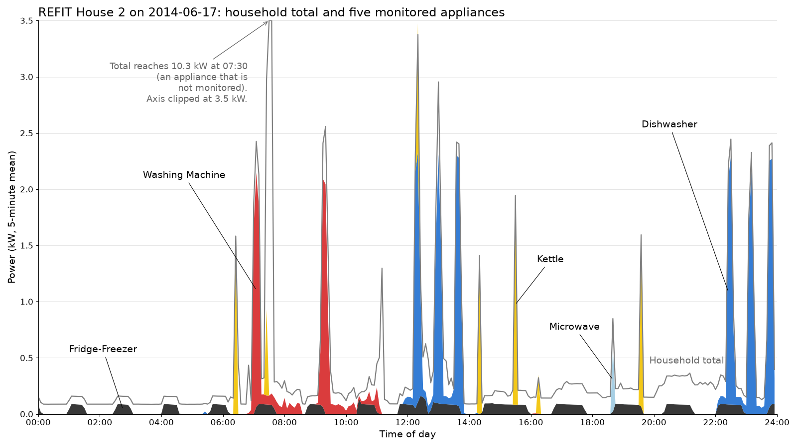
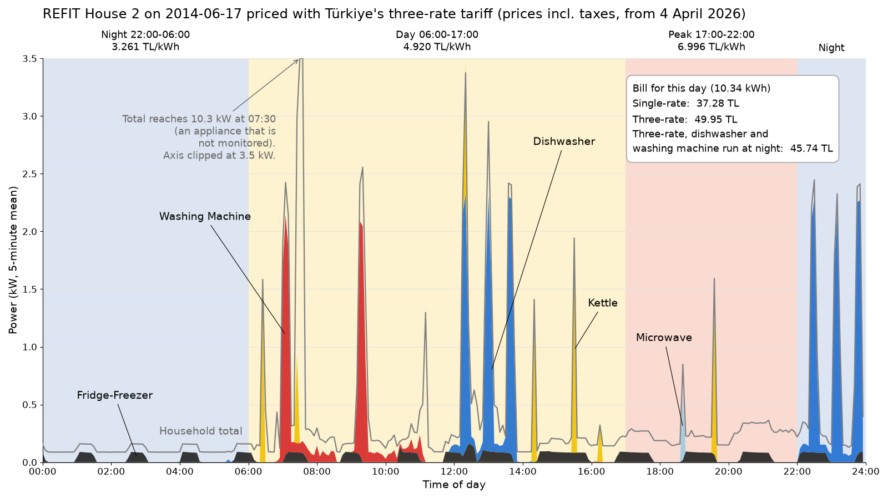

# Fatura Dedektifi (Bill Detective)

Samsung Innovation Campus, Artificial Intelligence Course, Capstone Group 14

An electricity bill shows one total. It does not show which appliance used how much. This project estimates the consumption of the fridge, the washing machine, the dishwasher, the kettle and the microwave from the total power signal of a home, with no extra meter on any appliance. The task is known as non-intrusive load monitoring (NILM).

The project relates to SDG 7, Affordable and Clean Energy, mainly target 7.3 on energy efficiency.



The grey line is what the meter sees. The coloured areas are what each appliance drew on the same day. The model has to recover the colours from the grey line alone. On this day the dishwasher used 2.72 of the home's 10.34 kWh.

## Türkçe özet

Elektrik faturasında tek bir toplam yazar, hangi cihazın ne kadar harcadığı yazmaz. Bu proje, evin toplam güç sinyaline bakarak buzdolabı, çamaşır makinesi, bulaşık makinesi, su ısıtıcı ve mikrodalganın tüketimini tahmin etmeyi amaçlıyor. Cihazlara ayrı sayaç takmak gerekmiyor. Proje SDG 7 (Erişilebilir ve Temiz Enerji) ile, özellikle enerji verimliliği hedefiyle (7.3) ilgili. Belgelerin Türkçe sürümleri aşağıdaki tabloda.

## Assignments

| No | Assignment | Files |
|---|---|---|
| 01 | Idea proposal | [Proposal (EN)](01_idea_proposal/Fatura_Dedektifi_Group14_Idea_Proposal_EN.pdf), [Fikir önerisi (TR)](01_idea_proposal/Fatura_Dedektifi_Grup14_Fikir_Onerisi_TR.pdf), [Slides (EN)](01_idea_proposal/slides/Fatura_Dedektifi_Group14_Slides_EN.pdf), [Slaytlar (TR)](01_idea_proposal/slides/Fatura_Dedektifi_Group14_Slides_TR.pdf), [first analysis](01_idea_proposal/analysis/) |

| 02 | Adapting the project to Türkiye | [Summary](02_turkiye_adaptation/), [Turkish load profile and tariff choice](02_turkiye_adaptation/profile/), [adaptation experiments](02_turkiye_adaptation/experiments/) |

Later assignments will get their own numbered folders.

## First results

These come from [01_idea_proposal/analysis/first_look.py](01_idea_proposal/analysis/first_look.py). Two simple baselines were trained on House 2 and tested on House 5 at 1-minute resolution. The score is the mean absolute error in watts, so lower is better.

| Appliance | Predict the mean | Gradient boosting |
|---|---|---|
| Kettle | 44.9 | 17.6 |
| Dishwasher | 107.1 | 67.6 |
| Washing machine | 44.3 | 43.6 |
| Microwave | 30.2 | 30.0 |
| Fridge-freezer | 55.6 | 48.0 |

Gradient boosting on window statistics helps for the kettle and the dishwasher. It barely helps for the washing machine and the microwave. The planned model is a small 1D convolutional network per appliance (sequence-to-point), and the target is to beat gradient boosting for at least four of the five appliances on homes the model has not seen.

These numbers use one training home and one test home, so they are a starting point and will change when more homes are used.

## Cost with the Turkish tariff

The instructor's feedback on the idea presentation was to price the result with Türkiye's day and night tariff. [tariff_cost.py](01_idea_proposal/analysis/tariff_cost.py) does this for the day shown above, using EPDK's regulated residential tariff valid from 4 April 2026 with taxes added by calculation.

| Tariff | TL per kWh |
|---|---|
| Three-rate, night (22:00 to 06:00) | 3.26 |
| Three-rate, day (06:00 to 17:00) | 4.92 |
| Three-rate, peak (17:00 to 22:00) | 7.00 |
| Single-rate, up to 8 kWh a day | 3.24 |
| Single-rate, above 8 kWh a day | 4.86 |



The day used 10.34 kWh. It costs 37.28 TL on the single-rate tariff and 49.95 TL on the three-rate tariff. Moving the midday dishwasher run and the morning wash to the night (2.54 kWh) lowers the three-rate bill to 45.74 TL, which is still above the single rate. The first 8 kWh of the single-rate tariff cost almost the same as night electricity, so the three-rate tariff only pays off for a home that can move most of its use to the night. The demo will make this comparison for any home and name the appliance worth moving.

Prices change, and the tax add-on (5% consumption tax on the energy part, then 10% VAT) should be checked against a real bill.

## Adapting UK data to Türkiye

The homes in the data are British and I found no open appliance-level data from Türkiye. Both countries use 230 V at 50 Hz, and the five target appliances are also used in Turkish homes. The plan has four steps.

1. Test the model on a second dataset. D'Incecco, Squartini and Zhong (2019) report that a model trained on REFIT has an error of 11.8 W on another UK dataset and 32.1 W on US homes, where a model trained locally reaches 23.7 W.
2. Add loads that are common in Turkish homes and missing in REFIT (air conditioner, electric water heater, tea maker) to the training data artificially.
3. Evaluate at 1-minute, 15-minute and hourly resolution, because the smart meters now being installed in Türkiye are reported to give hourly data.
4. Measure one Turkish home with smart plugs for a few weeks and report the error on that data.

Steps 2 and 3 now have first measurements, and a Turkish load profile was added. The details are in [02_turkiye_adaptation/](02_turkiye_adaptation/).

- EPİAŞ's 2025 residential profile puts 46.8% of household energy in the day band, 22.6% in the peak band and 30.6% in the night band. With that shape the three-rate tariff costs 240 to 400 TL more per month than the single-rate tariff at 4.9 to 15 kWh a day. Up to 8 kWh a day it can never be cheaper. At 10 kWh a day a home would need 87% of its use at night.
- At 15-minute resolution the gradient boosting baseline loses almost nothing in daily energy. At hourly resolution the dishwasher's daily error rises from 74% to 96%.
- Synthetic air conditioner, water heater and tea maker loads raise the kettle error from 20.8 W to 35.3 W when the model has never seen them. Retraining with the loads brings it back to 24.4 W.
- Four REFIT homes priced over 10 to 17 months each are cheaper on the single-rate tariff in every month. Moving the dishwasher and washing machine to the night saves 16 to 140 TL a month on the three-rate tariff.

## Data

REFIT Electrical Load Measurements (Cleaned), University of Strathclyde, CC BY 4.0. It has 20 UK homes recorded between 2013 and 2015, with the household total and nine appliance channels about every 8 seconds, 119.5 million rows in total. The data files are not stored in this repository. [The analysis README](01_idea_proposal/analysis/README.md) explains how to download them.

Murray, D., Stankovic, L. and Stankovic, V. (2017). An electrical load measurements dataset of United Kingdom households from a two-year longitudinal study. Scientific Data 4, 160122. https://doi.org/10.1038/sdata.2016.122

## Repository layout

```
01_idea_proposal/
  Fatura_Dedektifi_Group14_Idea_Proposal_EN.pdf, .docx    one-page proposal
  Fatura_Dedektifi_Grup14_Fikir_Onerisi_TR.pdf, .docx     the same proposal in Turkish
  proposal_src/                                           script that builds both proposal files
  slides/                                                 slide deck (11 slides) and narration text, EN and TR
  slides/src/                                             script, fonts and HTML that build the slides
  analysis/                                               scripts, results and figures for the first numbers and the tariff cost
02_turkiye_adaptation/
  profile/                                                Turkish residential load profile (EPİAŞ) and tariff choice
  experiments/                                            resolution, Turkish loads and yearly bills on four REFIT homes
```

## Team

Mert Güngör ([mert-gng-99](https://github.com/mert-gng-99))
